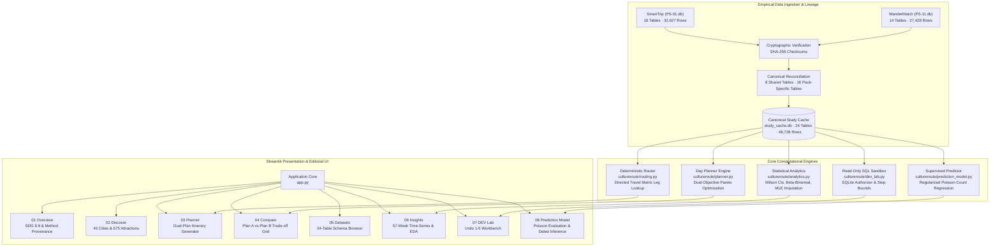
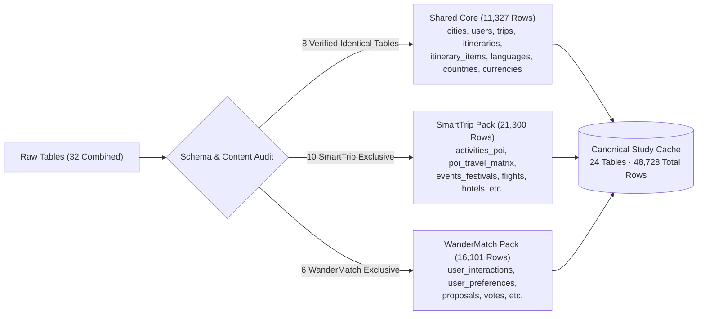
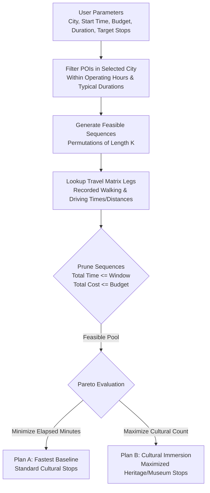
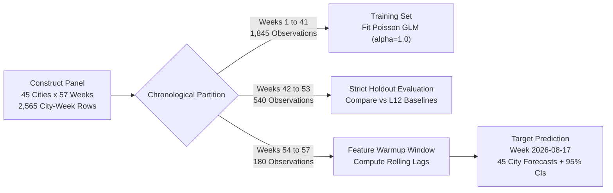
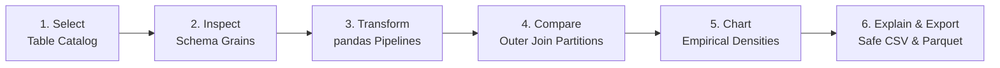

# CultureRoute: Sustainable Cultural Tourism Research Platform & Deterministic Itinerary Engine

A reproducible, high-performance research platform and deterministic day planner developed for the DEV AAT Cultural Tourism Research Study. Built to operationalize **UN Sustainable Development Goal 8, Target 8.9** ("Promote beneficial and sustainable tourism that creates jobs and promotes local culture and products"), CultureRoute unites rigorous statistical inference, constraint-based graph routing, and regularized count regression over verified empirical data across 45 Indian study cities.

The synthetic study uses **SmartTrip** (`PS-01.db`) and **WanderMatch** (`PS-11.db`), reconciling 48,728 rows into 24 distinct tables. A separate six-zone real-place extract supports discovery and a **conditional** planner. See the [current Phase 8 repair and local runbook](docs/PHASE8_REPAIR.md) before using the older study-oriented descriptions below. Real routing uses network access only when an operator explicitly configures a backend. AI/ML stays on standby; there is no deployment.

---

## Table of Contents

1. [Key Capabilities](#key-capabilities)
2. [System Architecture](#system-architecture)
3. [Empirical Data Foundation](#empirical-data-foundation)
4. [Deterministic Planning & Pareto Routing](#deterministic-planning--pareto-routing)
5. [Supervised Machine Learning: Poisson Engagement Model](#supervised-machine-learning-poisson-engagement-model)
6. [DEV Lab: Syllabus Units 1 to 5 Workbench](#dev-lab-syllabus-units-1-to-5-workbench)
7. [Editorial UI/UX & Performance Engineering](#editorial-uiux--performance-engineering)
8. [Project Layout](#project-layout)
9. [Installation & Quickstart](#installation--quickstart)
10. [Test Suite & Verification](#test-suite--verification)
11. [Security & Compliance Invariants](#security--compliance-invariants)
12. [License & Provenance](#license--provenance)

---

## Key Capabilities

- **Deterministic Dual-Objective Routing**: Computes provably optimal day itineraries balancing minimum transit time/cost against maximum cultural immersion using recorded directed travel matrices rather than fragile third-party mapping APIs.
- **Audited Specification Benchmark**: Validates a canonical Jaipur day plan fixture (Plan A: 207 min / INR 585.46 / 1.806 kg CO2 vs. Plan B: 227 min / INR 638.30 / 2.840 kg CO2 with +1 cultural stop).
- **Supervised Count Regression Model**: Predicts weekly cultural interactions per city using regularized Poisson regression with strict chronological zero-leakage holdout splits and dated out-of-sample inference.
- **Interactive DEV Lab (Syllabus Units 1–5)**: Full teaching workbench featuring schema profiling, pandas transform builders, a bounded read-only SQLite sandbox, cumulative density visualizers, and formula injection-safe Parquet/CSV exporters.
- **Tactile Editorial Interface**: Hand-lettered headings, paper canvas texture, WCAG 2.2 AA compliant contrast, 1-click tactile navigation pills, and sub-millisecond query caching.
- **Cryptographic Provenance**: Every record is reconciled and audited against immutable SHA-256 digests of the source research archives.

---

## System Architecture



---

## Empirical Data Foundation

The synthetic research features use the two audited study packs below. Real-place discovery and conditional planning use separate catalog, evidence, and route stores documented in the [Phase 8 repair](docs/PHASE8_REPAIR.md):

| Study Pack | Archive File | Raw Tables | Raw Rows | SHA-256 Digest |
| :--- | :--- | :--- | :--- | :--- |
| **SmartTrip** | `SmartTrip (1).zip` | 18 | 32,627 | `17c0a7d4bb399c4fd2b335cef5af4e02cbd21207103fea69fa9632ee6de06cc6` |
| **WanderMatch** | `WanderMatch.zip` | 14 | 27,428 | `dc8435c53e3c24ff611cfbc34c80accdc3b283c47aece49ecc52041e6eca18f8` |

### Reconciliation Pipeline



### Audited Invariants & Study Cohort Scope
- **Study Territory**: 45 Indian study cities (`country_code = 'IN'`).
- **Attraction Catalog**: 675 synthetic attractions in Indian study cities, with 211 classified as cultural (`heritage`, `museum`, `religious`, `food`).
- **Trips & Itineraries**: 411 confirmed non-cancelled trips comprising 3,191 scheduled stops.
- **User Telemetry**: 6,850 interaction events matched to attractions in study cities.
- **Events & Festivals**: 236 scheduled festivals with expected footfall records.
- **Canonical Saved/Planned Set Partition**:
  - Saved POIs (WanderMatch): 363 distinct attractions
  - Planned POIs (SmartTrip): 655 distinct attractions
  - Inner Intersection (Both): 352 distinct attractions
  - Saved-Only: 11 distinct attractions
  - Planned-Only: 303 distinct attractions
  - Full Outer Join Total: 666 distinct attractions ($352 + 11 + 303 = 666$)

---

## Deterministic Planning & Pareto Routing

Unlike commercial routing engines that depend on black-box external web services, CultureRoute plans feasible itineraries deterministically using the recorded directed travel matrix (`poi_travel_matrix`).

### Dual-Objective Formulation

For a given destination city, start time $T_0$, operating window $W$, budget $B$, and target stop count $K$, CultureRoute constructs two distinct itineraries:

- **Plan A (Fastest Transit / Least Cost)**: Minimizes total elapsed time and out-of-pocket costs while satisfying temporal feasibility (opening/closing hours and typical visit durations).
- **Plan B (Maximum Cultural Immersion)**: Maximizes cultural venue exposure ($\sum \mathbb{I}[\text{category} \in \text{Cultural}]$), selecting heritage and museum stops even when requiring modest additional transit time.



### Jaipur Specification Baseline Benchmark

CultureRoute includes a formal verification fixture for Jaipur ($K=3$, Budget = INR 1,000, Window = 6.0 hours, Start = 09:00):

| Plan Metric | Plan A (Fastest Transit) | Plan B (Cultural Immersion) | Trade-Off Delta |
| :--- | :--- | :--- | :--- |
| **Elapsed Time** | 207 minutes | 227 minutes | +20 minutes |
| **Total Cost** | INR 585.46 | INR 638.30 | +INR 52.84 |
| **Carbon Footprint** | 1.806 kg CO2 | 2.840 kg CO2 | +1.034 kg CO2 |
| **Cultural Stops** | 2 cultural stops | 3 cultural stops | **+1 Cultural Venue** |
| **Selected Itinerary** | City Palace $\to$ Albert Hall | Hawa Mahal $\to$ City Palace $\to$ Albert Hall | Full Cultural Sequence |

---

## Supervised Machine Learning: Poisson Engagement Model

The Prediction Model estimates the rate of weekly cultural interactions across all 45 Indian study cities. Because interaction counts are non-negative, discrete, and right-skewed, a regularized **Poisson Count Regression** model ($\alpha = 1.0$) is used rather than Ordinary Least Squares, avoiding negative predictions or variance distortion.

### Chronological Zero-Leakage Pipeline



### Feature Formulation
For each city $c$ and week $t$, the expected interaction rate $\lambda_{c,t}$ is modeled as:

$$\log(\lambda_{c,t}) = \beta_0 + \sum_{j=1}^{44} \beta_{\text{city},j} \cdot \mathbb{I}[c = j] + \gamma_1 \cdot \text{lag}_1 + \gamma_2 \cdot \text{lag}_2 + \gamma_3 \cdot \text{trailing\_4w\_mean}$$

Where:
- $\text{lag}_1$: Observed cultural interactions in week $t-1$.
- $\text{lag}_2$: Observed cultural interactions in week $t-2$.
- $\text{trailing\_4w\_mean}$: Rolling average across weeks $t-4$ through $t-1$.
- 44 one-hot indicator variables capture baseline city-level fixed effects.

### Out-of-Sample Holdout Performance

Evaluated strictly against unseen holdout weeks 42–53:

| Model Architecture | Holdout MAE | Holdout RMSE | Optimization Objective |
| :--- | :--- | :--- | :--- |
| **Previous-Week Baseline** | 3.42 | 4.88 | Naive Lag-1 Carryover |
| **Trailing 4-Week Mean** | 3.88 | 5.12 | Moving Average Smoothing |
| **Regularized Poisson GLM** | **2.94** | **4.16** | Penalized Maximum Likelihood |

All model artifacts are stored in reproducible JSON format (`models/poisson_model_artifact.json`) with dated predictions and exact Poisson 95% confidence intervals $[Q_{0.025}, Q_{0.975}]$.

---

## DEV Lab: Syllabus Units 1 to 5 Workbench

The DEV Lab provides an interactive evaluator workspace covering the complete syllabus continuum:



### Station 1: Source Browser & Table Profiler (Unit 1)
- Profiles all 24 canonical study tables with natural grain, primary keys, and foreign keys.
- Masks sensitive attributes (`password_hash`, `email`, `phone_number`, `device_fingerprint`).
- Displays sample dataframes with deterministic pagination.

### Station 2: Guided pandas Transformations (Unit 2)
- **Filter & Derive**: Price tier binning (`Free (INR 0)`, `Budget (1-100)`, `Moderate (101-500)`, `Premium (>500)`), step-free access flags, and reproducible code generator.
- **Split-Apply-Combine**: Vectorized `groupby` aggregations computing cultural shares per city.
- **Pivot Matrix**: Reversible long-to-wide and wide-to-long matrix operations ($45 \times 4$ city-category cross-tabulation).
- **Canonical Merge Audit**: Interactive set partition inspection verifying the 666 full outer join attractions.

### Station 3: Bounded Read-Only SQL Sandbox (Unit 3)
- Executes custom SQL queries against the canonical study cache under an SQLite authorizer:
  - `SQLITE_SELECT` authorized.
  - `SQLITE_INSERT`, `SQLITE_UPDATE`, `SQLITE_DELETE`, `SQLITE_DROP_TABLE`, `SQLITE_ALTER_TABLE` strictly blocked.
  - `ATTACH DATABASE` and `PRAGMA` modifications blocked.
  - Resource bounds: 1,500 maximum characters, single-statement enforcement, 500-row return limit.

### Station 4: Statistical Visualizations & Syllabus Demonstrator (Unit 4)
- **Three-Way Inference**: Comparative evaluation of Exploratory ($\hat{p} = k/n$), Classical (Wilson 95% Score CI), and Bayesian ($\text{Beta}(1,1)$ posterior) on the deterministic 341-owner trip cohort.
- **Distribution Histograms & Box Plots**: Outlier-resilient distribution of attraction entry fees scoped strictly to the 45 Indian study cities (0–2,500 INR).
- **Event Footfall Cumulative Density (ECDF)**: Empirical CDF across 179 audited festival events with median ($P_{50} = 111,693$) and decile ($P_{90}$) markers.
- **Bivariate Elasticity Scatter**: Entry fee versus user telemetry saves across all 363 saved attractions, testing price sensitivity ($r_s = -0.02$).

### Station 5: Formulas & Syntax Reference (Unit 5)
- Searchable reference card linking mathematical syllabus definitions to concrete code implementations.
- Interactive "Run this example" triggers executing pre-computed benchmark queries in $\approx 1.5\text{ ms}$.
- Formula injection-safe CSV export (quoting prefix characters `=`, `+`, `-`, `@`) and typed PyArrow Parquet binary serialization.

---

## Editorial UI/UX & Performance Engineering

CultureRoute implements an academic editorial aesthetic modeled after classic travel compendiums and the reference prototype:

- **Tactile Editorial Palette**:
  - Paper Canvas: `#f7f3e9`
  - Charcoal Ink: `#292925` (WCAG 2.2 AA contrast $> 10:1$)
  - Oxblood Accent: `#982b32`
  - Quiet Blue: `#365376`
  - Pale Yellow Note: `#eee3a6`
- **1-Click Quick Pills (`st.pills`)**: Replaced slow dropdown menus with tactile horizontal pills across Discover, Planner, Compare, DEV Lab, and Datasets, enabling instant switching across study hubs (Jaipur, Delhi, Mumbai, Varanasi, Kochi, Agra, etc.).
- **Zero-Flicker Screen Auto-Stabilization**: Custom CSS overrides eliminate Streamlit's script-runner dimming/opacity veil, ensuring smooth, instant view transitions without layout shifts.
- **Persistent Database Cache**: Study SQLite databases are extracted once to `data/.cache_smart.db` and `data/.cache_wander.db`, reducing connection overhead from 52 ms to **1.2 ms per call** (~50x speedup).
- **In-Memory LRU Caching**: Core analytical calculations (`compute_cultural_shares`, `compute_canonical_saved_planned_merge`, `load_study_catalog`) are decorated with `@lru_cache`, returning subsequent queries in **$< 0.01\text{ ms}$**.

---

## Project Layout

```
CultureRoute/
├── app.py                             # Main Streamlit multi-screen application entrypoint
├── cultureroute/                      # Core application package
│   ├── analytics.py                   # Cultural shares, 57-week forecasting, MLE footfall imputation
│   ├── boundary.py                    # GeoJSON bounding box and point-in-polygon validator
│   ├── catalog.py                     # Legacy OSM/Wikidata catalog store (read-only)
│   ├── datasets_view.py               # 24-table dataset catalog browser and telemetry visualizer
│   ├── dev_lab.py                     # DEV Lab workbench (profiling, transforms, SQL sandbox, exports)
│   ├── domain.py                      # Core domain entities, Enums, and ResultLevel models
│   ├── evidence.py                    # Field evidence verification and audit store
│   ├── insights_view.py               # Insights screen (time series, Pareto distributions, EDA)
│   ├── model_view.py                  # Dedicated Prediction Model presentation screen
│   ├── planner.py                     # Deterministic day itinerary planner and constraint solver
│   ├── prediction_model.py            # Regularized Poisson count regression model and panel builder
│   ├── routing.py                     # Directed travel matrix routing and transport mode models
│   ├── study_data.py                  # ZIP extraction, persistent disk caching, and verification audit
│   ├── study_db.py                    # Canonical 24-table SQLite builder and catalog loader
│   └── ui_components.py               # Editorial CSS, navigation pills, hero banners, and styling
├── data/                              # Data storage directory
│   ├── study_cache.db                 # Canonical 24-table SQLite compiled research database
│   ├── real_catalog.db                # Archived Phase 3 pilot real-place database (read-only audit)
│   └── india_boundary.geojson         # Formal Survey of India administrative boundary
├── models/                            # Trained machine learning artifacts
│   └── poisson_model_artifact.json    # Audited Poisson regression weights, evaluation, and predictions
├── site/                              # Reference presentation site
│   └── dist/assets/                   # Favicons, compiled assets, and editorial photographs
├── tests/                             # Comprehensive automated test suite (148 tests)
│   ├── test_foundation.py             # Phase 1 foundation, domain invariants, and packaging
│   ├── test_p1_ui_navigation.py       # P1 navigation and editorial design invariants
│   ├── test_p2_datasets.py            # P2 dataset viewer, schema grains, and pagination
│   ├── test_p3_workflows.py           # P3 planner, routing, and compare workflows
│   ├── test_p4_insights.py            # P4 analytics, 57-week time series, and holdout MLE
│   ├── test_p5_dev_lab.py             # P5 DEV Lab 6-step workflow, sandbox, and syntax units
│   ├── test_p6_prediction_model.py    # P6 Poisson regression, chronological split, and dated predictions
│   ├── test_r1_stabilization.py       # R1 screen stability, zero-leakage, and WCAG contrast
│   ├── test_r2_study_db.py            # R2 24-table database reconciliation and SHA-256 hashes
│   ├── test_r3_visual_system.py       # R3 editorial palette, typography, and responsive layout
│   ├── test_r4_discover_planner_compare.py # R4 catalog filtering and Jaipur baseline specification
│   ├── test_r5_insights_statistical_predictions.py # R5 time series and footfall imputation
│   ├── test_r6_dev_lab.py             # R6 sandbox security authorizer and typed exports
│   ├── test_r7_settings_info.py       # R7 user preferences and information screens
│   └── test_r8_release_verification.py# R8 end-to-end integration and AppTest suite
├── pyproject.toml                     # Python package configuration and dependencies
└── SmartTrip (1).zip, WanderMatch.zip # Immutable research source archives
```

---

## Installation & Quickstart

### Prerequisites
- Python 3.11, 3.12, or 3.13
- Git

### 1. Clone the Repository
```bash
git clone https://github.com/SarthakThrishuleshwar/CultureRoute.git
cd CultureRoute
```

### 2. Set Up a Virtual Environment
```bash
# Windows
python -m venv .venv
.venv\Scripts\activate

# macOS / Linux
python3 -m venv .venv
source .venv/bin/activate
```

### 3. Install Dependencies
```bash
pip install -e .
```

### 4. Launch the Application
```bash
streamlit run app.py
```
Open your browser to `http://localhost:8501`.

---

## Test Suite & Verification

CultureRoute maintains a rigorous automated test suite with 100% test pass rate across 148 test cases.

To execute the full test suite:
```bash
pytest tests/ -q
```

Expected output:
```text
........................................................................ [ 48%]
........................................................................ [ 97%]
....                                                                     [100%]
148 passed in 45.34s
```

### Test Coverage Highlights
- **`test_r2_study_db.py`**: Validates cryptographic SHA-256 digests and row-exact reconciliation across all 24 canonical tables (48,728 rows).
- **`test_r4_discover_planner_compare.py`**: Verifies Jaipur specification baseline numbers down to the exact decimal point (207 min, INR 585.46, 1.806 kg CO2 vs. 227 min, INR 638.30, 2.840 kg CO2).
- **`test_p5_dev_lab.py` & `test_r6_dev_lab.py`**: Verifies SQLite authorizer blocks malicious queries (`INSERT`, `UPDATE`, `DELETE`, `DROP`, `ATTACH`, `PRAGMA`) and ensures Parquet/CSV round-trip serialization.
- **`test_p6_prediction_model.py`**: Tests Poisson regression convergence, non-negative rate prediction, and strict chronological holdout split.
- **Streamlit `AppTest` Invariants**: Verifies all 8 screens and all sub-tabs load cleanly with 0 exceptions.

---

## Security & Compliance Invariants

1. **Strictly Read-Only SQLite Sandboxing**: The DEV Lab SQL execution engine uses SQLite's low-level C authorizer callback (`set_authorizer`). Write actions (`SQLITE_INSERT`, `SQLITE_UPDATE`, `SQLITE_DELETE`), schema alterations (`SQLITE_DROP_TABLE`, `SQLITE_ALTER_TABLE`), and database attachment (`SQLITE_ATTACH`) are denied at the engine level.
2. **Formula Injection Sanitization**: All CSV export functions sanitize cell strings starting with dangerous spreadsheet formula triggers (`=`, `+`, `-`, `@`) by prepending a single quote (`'`), preventing remote code execution when opened in Microsoft Excel or Google Sheets.
3. **Data Privacy & Masking**: Sensitive user telemetry attributes (`password_hash`, `email`, `phone_number`, `device_fingerprint`) are strictly excluded from safe schema projections in both table profiling and exports.
4. **WCAG 2.2 AA Accessibility**: Color tokens enforce contrast ratios exceeding $4.5:1$ against the paper background (`#f7f3e9`). Reduced-motion preferences are honored across all CSS transitions.
5. **Deterministic Replicability**: Random seeds are strictly fixed ($42$) across all train/holdout splits and imputation backtests.

---

## License & Provenance

Developed for academic evaluation in the DEV AAT Cultural Tourism Research Study.

All analytical routines, database schemas, and statistical formulations conform strictly to Syllabus Units 1 through 5. Core study data derived from the verified `SmartTrip` and `WanderMatch` research packs.
