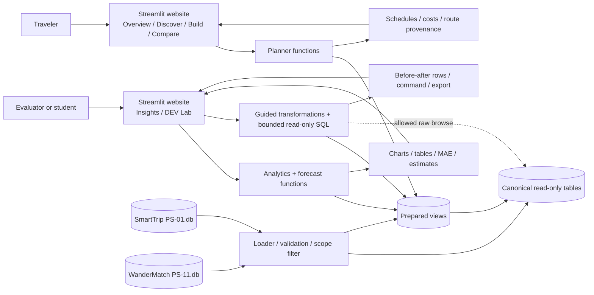
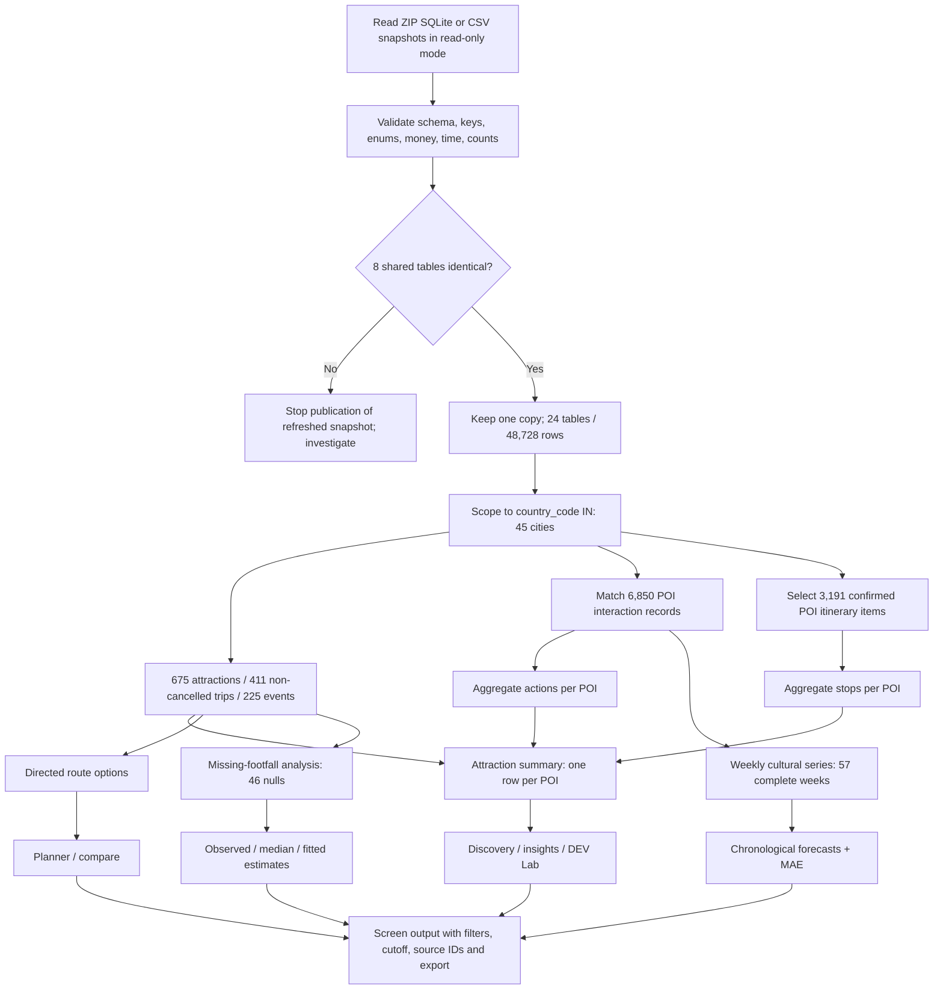

# CultureRoute overall system and pipeline architecture

**Status:** Original target architecture; [current local architecture](PHASE8_REPAIR.md) runs Streamlit with separate synthetic and real pipelines. Routing is opt-in, walking requires a verified pedestrian graph, AI/ML remains on standby, and deployment is pending.
**References:** `CultureRoute_DEV_AAT_Project_Specification.pdf` pp. 2–8; [`PRD.md`](PRD.md), [`TRD.md`](TRD.md), [`DATABASE.md`](DATABASE.md)

## 1. Architecture intent

The synthetic pipeline prepares the two supplied travel packs for planning, descriptive analytics, forecasting exercises, and the DEV Lab. A separate real-place pipeline publishes six-zone extracts, field evidence, and directed route responses into independent stores. The local Streamlit app exposes traveler and evaluator views using Python, SQLite, pandas, and Plotly. A deployed backend, production routing provider, and ML execution are not part of this repair. [Spec pp. 1, 4]

### Context and containers



No separate public REST API is required by the specification. The website can call Python functions in one process. If the team later separates services, the same request/response contracts in [`TRD.md`](TRD.md) should remain stable.

## 2. End-to-end data pipeline



This is a **snapshot batch pipeline**. The source provides no live update cadence or external ingestion service. A refresh is a controlled re-run, with validation before results are exposed. The pipeline should record source hashes/versions, code version, preparation timestamp, and cutoff dates. Whether prepared data are in-memory DataFrames, SQLite views, or a derived database is undecided. [Spec pp. 2, 4]

### Checkpoint table

| Boundary | Required check | Current supplied snapshot |
| --- | --- | ---: |
| Source inventory | Tables and raw row counts | SmartTrip 18/32,627; WanderMatch 14/27,428 |
| Shared-table resolution | Equal PK sets and row content | 8 tables / 11,327 copied rows |
| Canonical combined | Unique table names and rows | 24 / 48,728 |
| India study scope | Country code, not city names | 45 cities, 675 attractions, 411 non-cancelled trips |
| Engagement | Matched `entity_type='poi'` records | 6,850 |
| Selected planning | Active itinerary, confirmed POI item, non-cancelled India trip | 3,191 |
| Cultural shares | Independent grains and denominators | 211/675; 2,144/6,850; 961/3,191 |
| Forecast | Complete weeks and chronological holdout | 57 weeks; last-12 MAE 3.42 / 3.88 |

These checkpoints are reproduced by [`audit_sources.py`](audit_sources.py), except the Jaipur route fixture, which requires the planner implementation. Data changes should cause a documented baseline update, never an unnoticed silent drift.

## 3. Component responsibilities

| Component | Responsibility | Failure response | Provenance carried forward |
| --- | --- | --- | --- |
| Source reader | Open packs read-only and identify snapshot. | Reject missing/corrupt files. | ZIP/database path, file hash/version. |
| Validator | Check keys, shared equality, formats, counts, and joins. | Quarantine changed snapshot; report failed check. | Audit report and checked row counts. |
| Preparation | Build India and source-specific views at documented grains. | Fail on non-unique keys or unexpected cardinality. | Filter predicates, source IDs, code version. |
| Planner | Generate and rank feasible routes using directed legs. | Structured infeasibility and coverage/unknown-hours warnings. | POI IDs, matrix IDs, exact cost parts, input snapshot. |
| Analytics | Calculate metric tables and chart data. | Display no-data/partial-period state; never divide by zero. | Numerator, denominator, grain, filters, cutoff. |
| Forecast/estimation | Fit past-only baselines and missing-value methods. | Show insufficient history/fit diagnostics; do not invent prediction. | Training cutoff, evaluation dates, method, error. |
| DEV Lab | Run guided operations or bounded read-only SQL. | Show query/validation errors without state changes. | Command, source view, before/after and match counts. |
| UI/export | Render six screens and downloadable result tables. | Preserve inputs, explain failure and next action. | Visible method, metadata, source row drill-down. |

## 4. Request sequences

### Traveler route generation

```mermaid
sequenceDiagram
  actor Traveler
  participant UI as Streamlit Build/Compare
  participant Planner
  participant Views as Prepared views
  Traveler->>UI: Select city/day/start/budget/hours/stops/preferences
  UI->>UI: Validate and freeze input snapshot
  UI->>Planner: plan(request)
  Planner->>Views: Read city POIs, hours, prices, directed legs
  Views-->>Planner: Candidate rows + source IDs
  Planner->>Planner: Enumerate/bound sequences; check time, cost, opening
  Planner->>Planner: Rank fastest and most-cultural
  Planner-->>UI: Two plans or infeasibility + warnings + provenance
  UI-->>Traveler: Paired maps/timetables, costs, carbon, source rows
```

The exact search strategy and stop cap are open decisions. A changed input must invalidate the earlier pair before rerunning. [Spec pp. 4–5]

### DEV Lab transformation

```mermaid
sequenceDiagram
  actor Evaluator
  participant UI as Streamlit DEV Lab
  participant Engine as Transformation engine
  participant Views as Read-only raw/prepared tables
  Evaluator->>UI: Select view and guided operation or SQL
  UI->>Engine: Validate operation and limits
  Engine->>Views: Read allowed source rows
  Views-->>Engine: Rows, schema, grain
  Engine->>Engine: Execute; count before/after and key matches
  Engine-->>UI: Result, command, counts, source identifiers
  UI-->>Evaluator: Before/after table, chart, method, export
```

SQL authorizer, time limit, output cap, and allowlist are required design controls. Their numeric limits remain to be set. [Spec pp. 4–5]

## 5. Planner calculation boundary

The recorded `poi_travel_matrix` supplies origin POI, destination POI, mode, minutes, cost/currency, and carbon. The planner may choose only recorded walking or cab edges in their recorded direction. It adds attraction visit duration, waiting, entry fees, and between-stop leg values. The final schedule must fit the user's start/window/budget and known opening rules. In the India subset, 131 attractions have only one opening-hour endpoint; the planner must flag these as uncertain rather than asserting an opening interval. Entry plus between-stop travel is the displayed cost. Estimated between-stop carbon excludes travel to/from the first/last stop and does not measure actual emissions. Attraction accessibility is known; transfer accessibility is not. [Spec p. 4; source audit]

The Jaipur example in the specification is a **fixture** to reproduce, not proof that this workspace has a working planner. The static UI concept merely displays those baseline numbers. [Spec p. 5]

## 6. Analytics and prediction architecture

Prepared outputs must preserve their original grain. Listings are POI rows, interactions are action rows, and planned stops are confirmed itinerary-item rows. Aggregate interactions and selected stops separately by POI before attaching activity counts to the catalog. A city/category filter applies before computing each numerator and denominator. [Spec p. 2]

The weekly forecast consumes matched interactions on Indian cultural POIs. Build Monday–Sunday weeks from offset-aware timestamps; exclude the partial final week. Evaluate one-step predictions against the last 12 complete weeks using only earlier weeks. The current source reproduces last-week MAE **3.42** and trailing-four-week MAE **3.88**; both are descriptive baselines of synthetic activity, not live demand forecasts. The UI shows target dates, training cutoff, actuals, predictions, and MAE. [Spec p. 8]

The missing-footfall exercise reads 225 Indian events with 46 null values. Observed-only and median summaries are reproducible immediately. Distribution choice, maximum-likelihood fit diagnostics, and holdout scheme require an implementation decision. Keep imputed values in a derived result, never overwrite source nulls. [Spec p. 6]

## 7. Operational and access design

- **Source protection:** open original SQLite files in read-only mode; writes go only to derived artifacts if chosen. Use immutable snapshot inputs for a demo.
- **Evaluator SQL:** enforce read-only execution in code and SQLite, allowlist views, deny extension loading and `ATTACH` from user input, bound time and output. Display truncation.
- **Synthetic rows:** synthetic user emails/IDs do not represent real users, but still avoid presenting them as real people or adding live account claims.
- **Reproducibility:** pin source snapshot and preparation code; preserve generated values separately from observed data; use deterministic tie-breaks and holdout seeds.
- **Logging:** record operation ID, source version, filter set, duration, row counts, route rejection reasons, and query error category. Do not log arbitrary query text or user-entered data without a team decision.
- **Performance:** set measured budgets after an implementation exists; cache immutable prepared views if needed, keyed by source version. No numeric SLO is supplied.
- **Deployment:** unspecified. Streamlit can run locally for a demo, but hosting, authentication, multi-user isolation, and refresh scheduling must be documented if deployed.

## 8. Architecture decisions to record

| ID | Decision needed | Options and trade-off |
| --- | --- | --- |
| ADR-01 | Prepared view storage | In-memory pandas is simple; a derived SQLite store improves repeat queries and auditability. |
| ADR-02 | Planner search | Exact bounded enumeration is explainable for a small stop cap; heuristic search scales farther but can miss the optimum. |
| ADR-03 | Unknown hours | Exclude uncertain attractions, or show conditional routes with a clear warning. |
| ADR-04 | SQL limits | Choose row/time caps and allowed views based on actual data size and UX. |
| ADR-05 | Currency | INR-only first planner, or add an explicit dated conversion source. |
| ADR-06 | Deployment/access | Local demo versus hosted app; define persistence and isolation before multi-user use. |

The design remains reviewable without implying these choices have been implemented.
