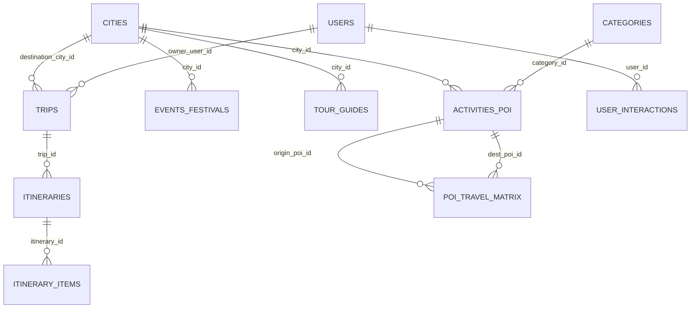
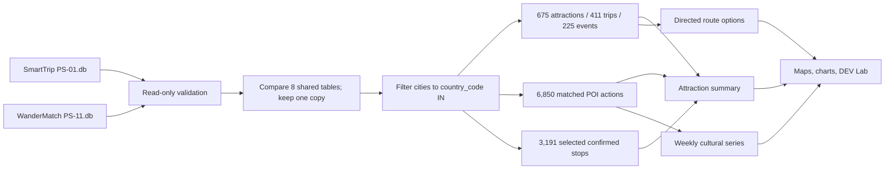

# CultureRoute database and data preparation

**Status:** Source schema and counts verified; prepared views are design definitions, not materialized tables  
**References:** `CultureRoute_DEV_AAT_Project_Specification.pdf` pp. 2, 4–8; `SmartTrip/data/PS-01.db`; `WanderMatch/data/PS-11.db`; [`DATA_DICTIONARY.md`](DATA_DICTIONARY.md)  
**Reproduce counts:** `python docs/audit_sources.py` from the workspace root

## 1. Source inventory and scope

The packs contain 32 source tables in total (18 SmartTrip, 14 WanderMatch). Eight are identical shared copies, verified row-for-row by primary key, so the canonical combined model contains **24 distinct tables and 48,728 rows**. Retaining one copy removes 11,327 duplicate source rows. All source data are synthetic. Raw row counts below are not India-filtered counts. [Spec p. 2; source audit]

| Canonical table | Raw rows | Origin | Main CultureRoute use |
| --- | ---: | --- | --- |
| `activities_poi` | 900 | SmartTrip | Attraction catalog, fees, durations, hours, accessibility, categories. |
| `airlines` | 30 | SmartTrip | Explorer reference for flights. |
| `airports` | 80 | SmartTrip | Explorer reference for flight origins/destinations. |
| `categories` | 70 | SmartTrip | Category labels and hierarchy. |
| `cities` | 60 | Shared | Geographic scope and city filters; 45 India rows. |
| `countries` | 30 | Shared | Country reference. |
| `currencies` | 25 | Shared | Currency code/display metadata. |
| `events_festivals` | 300 | SmartTrip | Missing-footfall exercise; 225 India rows. |
| `flight_fares` | 8,002 | SmartTrip | Explorer only, outside day-plan fare. |
| `flights` | 4,000 | SmartTrip | Explorer only. |
| `hotels` | 300 | SmartTrip | Explorer only. |
| `itineraries` | 803 | Shared | Active itinerary selection. |
| `itinerary_items` | 8,583 | Shared | Confirmed POI stops and provenance. |
| `languages` | 26 | Shared | BCP-47 language reference. |
| `place_kb` | 1,200 | SmartTrip | Explorer/context only unless a grounded-text feature is approved. |
| `poi_travel_matrix` | 6,418 | SmartTrip | Directed walking/cab legs, minutes, fare, carbon. |
| `trips` | 600 | Shared | Destination, status, owner, dates. |
| `users` | 1,200 | Shared | Synthetic owner/interaction links; not required as live accounts. |
| `proposals` | 274 | WanderMatch | Explorer and possible merge exercises. |
| `tour_guides` | 120 | WanderMatch | Guide languages and specialties in Discover. |
| `trip_members` | 1,407 | WanderMatch | Explorer; group-travel context. |
| `user_interactions` | 12,339 | WanderMatch | Matched POI engagement and weekly forecast. |
| `user_preferences` | 1,200 | WanderMatch | Preference examples; not proof of live personalization. |
| `votes` | 761 | WanderMatch | Explorer and possible transformation exercises. |

Shared tables: `cities`, `countries`, `currencies`, `languages`, `users`, `trips`, `itineraries`, and `itinerary_items`. Their copies are identical in the supplied snapshot. Any refreshed pack must be compared again before selecting a canonical copy. The full field-level schema, key flags, and nullability are in [`DATA_DICTIONARY.md`](DATA_DICTIONARY.md).

## 2. Core relationships



`user_interactions.entity_type + entity_id` and `itinerary_items.entity_type + entity_id` are polymorphic references; they are not ordinary foreign keys to `activities_poi`. Restrict to `entity_type='poi'` before matching `entity_id` to `poi_id`. Names can repeat; join IDs only. The travel matrix is directed, so `(A,B,walk)` is not interchangeable with `(B,A,walk)`. [Pack data models; Spec pp. 2, 4]

## 3. Study filters and prepared-view contracts

The scope filter is **`cities.country_code = 'IN'`**, not city-name matching. All 60 raw cities and 900 raw POIs are active; 45 cities and 675 POIs are in India. Each Indian city has 15 catalog POIs. The matrix has 10 distinct origin POIs per Indian city, so discovery and planning have different coverage. [Spec pp. 2, 5; source audit]

| Prepared view | Grain and exact scope | Verified rows | Consumers |
| --- | --- | ---: | --- |
| `india_cities` | One `cities` row where `country_code='IN'`. | 45 | City picker, comparisons. |
| `india_attractions` | One `activities_poi` joined by `city_id` to `india_cities`. | 675 | Catalog, category metrics, planner candidates. |
| `interaction_records` | One `user_interactions` row with `entity_type='poi'` and `entity_id` matching `india_attractions.poi_id`. No interaction-type exclusion. | 6,850 | Engagement charts, weekly forecast. |
| `selected_itinerary_stops` | One `itinerary_items` row with `item_type='poi'`, `entity_type='poi'`, `status='confirmed'`, matching POI ID in the trip destination city; linked itinerary `is_active=1`; linked trip destination India and `status<>'cancelled'`. | 3,191 | Planned-stop shares, saved/planned join. |
| `study_trips` | One trip with destination city India and `status<>'cancelled'`. | 411 | Trip summaries and scope label. |
| `route_options` | One `poi_travel_matrix` row per directed `(origin_poi_id, dest_poi_id, mode)`, scoped to Indian attraction endpoints. | 4,832 by Indian origin in this snapshot | Route search. |
| `india_events` | One `events_festivals` row in India. | 225 | Missing-footfall exercise. |
| `attraction_summary` | One India attraction, with separately aggregated interaction and selected-stop counts left-joined by `poi_id`. | 675 | Map, table, activity summary. |
| `weekly_cultural_engagement` | One Monday-start week over cultural `interaction_records`; mark final partial week. | 57 complete + 1 partial | Forecast/chart. |

The selected-stop check finds zero rows where the matched POI's city differs from the trip's destination in the supplied snapshot. Keep that as a validation gate, not an assumption for future data.

### Reconciliation SQL (SmartTrip database as `main`, WanderMatch attached as `wm`)

```sql
-- Open both source files read-only in the application. Attach the second read-only.
-- Canonical India attractions: 675.
SELECT count(*)
FROM activities_poi a JOIN cities c ON c.city_id = a.city_id
WHERE c.country_code = 'IN';

-- Matched POI actions: 6,850. Keep every interaction type.
SELECT count(*)
FROM wm.user_interactions u
JOIN activities_poi a ON u.entity_type = 'poi' AND u.entity_id = a.poi_id
JOIN cities c ON c.city_id = a.city_id
WHERE c.country_code = 'IN';

-- Selected planned POI stops: 3,191.
SELECT count(*)
FROM itinerary_items ii
JOIN itineraries i ON i.itinerary_id = ii.itinerary_id
JOIN trips t ON t.trip_id = i.trip_id
JOIN cities c ON c.city_id = t.destination_city_id
JOIN activities_poi a ON a.poi_id = ii.entity_id
WHERE c.country_code = 'IN'
  AND t.status <> 'cancelled'
  AND i.is_active = 1
  AND ii.status = 'confirmed'
  AND ii.item_type = 'poi'
  AND ii.entity_type = 'poi'
  AND a.city_id = t.destination_city_id;
```

`attraction_summary` must first `GROUP BY poi_id` independently in `interaction_records` and `selected_itinerary_stops`, then left join the two one-row-per-POI aggregates to `india_attractions`. A direct three-way raw join multiplies event and stop counts: three saves and four stop appearances become twelve joined rows. [Spec p. 2]



## 4. Metric dictionary

“Cultural” means `poi_category IN ('heritage','museum','religious','food')`. Percentages round to one decimal place for display; store unrounded numerators and denominators. [Spec p. 2; source audit]

| Metric | Numerator | Denominator | Result | Notes |
| --- | ---: | ---: | ---: | --- |
| Cultural listing share | 211 India cultural POIs | 675 India POIs | 31.3% | One row per POI. |
| Cultural interaction share | 2,144 matched actions on cultural POIs | 6,850 matched actions on India POIs | 31.3% | One row per action, including views/searches/etc. |
| Cultural selected-stop share | 961 cultural selected items | 3,191 selected items | 30.1% | One row per confirmed item; repeated POI visits count separately. |
| India trip count | 411 non-cancelled India-destination trips | N/A | 411 | Includes draft/planning/confirmed/in-progress/completed, excludes cancelled. |
| Missing event footfall | 46 null `expected_footfall` | 225 India events | 20.4% | Null is not zero. |
| Planner coverage | 10 matrix-covered POIs per city | 15 catalog POIs per city | 10/15 | Explain coverage gap in UI. |

Every filtered city/category result must recompute both numerator and denominator under the **same** filter and show the filter. A denominator of all actions cannot be paired with a numerator of unique attractions. The research compares three populations; their percentages are not a funnel or causal conversion rate.

## 5. Saved-versus-planned merge exercise

Create a distinct ID set of saved India POIs from `interaction_records WHERE interaction_type='save'` and a distinct ID set of planned India POIs from `selected_itinerary_stops`. Join on `poi_id`, with a `match_status` field. The current snapshot has **363 saved IDs**, **655 planned IDs**, **352 both**, **11 saved only**, **303 planned only**, and **666 in the union/full outer**. These counts reconcile as 352+11=363 and 352+303=655. Rows in the outer result may have a null side; null does not mean a missing source POI. [Spec p. 5; source audit]

## 6. Data quality and format rules

- Verify PK uniqueness and all declared foreign keys; also validate polymorphic POI references when a view expects them.
- Treat IDs as opaque prefixed strings. Do not parse suffixes or join names.
- Keep monetary fields as decimal strings in SQLite/CSV and convert to Python `Decimal` for sums. Check currency compatibility; never sum different currencies without an explicit conversion source.
- Preserve ISO-8601 offset timestamps, date-only fields, BCP-47 language tags, WGS-84 coordinates, legal enum values, and status rows. [Pack `data/WORKING_WITH_THE_DATA.md`]
- Of 675 India attractions, 537 have both `opens_at` and `closes_at`, 67 lack close time only, 64 lack open time only, and seven lack both. The pack data model describes null hours as “always open”, but a single missing endpoint does not establish a complete daily interval. Treat partial hours as unknown and require a documented policy for paired nulls; flag uncertain routes. Do not turn missing event footfall into zero.
- Run row-count and cardinality checkpoints on every source refresh: eight shared tables equal, 45 India cities, 15 attractions per city, 10 matrix-covered origin POIs per city, selected-stop city agrees with trip destination, and published metric counts reconcile.
- Store provenance with prepared outputs: source pack/version, table, row IDs, filter predicate, source cutoff, and preparation-code version. Actual storage format is an implementation decision.

## 7. Indexes and refresh

Existing SQLite packs are indexed. If a derived local store is added, useful indexes are `activities_poi(city_id,poi_category)`, `user_interactions(entity_type,entity_id,occurred_at)`, `itinerary_items(itinerary_id,status,item_type,entity_id)`, `trips(destination_city_id,status)`, and `poi_travel_matrix(origin_poi_id,dest_poi_id,mode)`. Do not mutate the supplied databases to add indexes; create a separate derived copy if needed. A source refresh should run validation, rebuild prepared views, re-evaluate baselines, and record a new cutoff/version before UI results are served. [Spec p. 4]

## 8. Full schema

See [`DATA_DICTIONARY.md`](DATA_DICTIONARY.md) for every supplied column, SQLite type, required flag, PK, and declared FK. The original ZIP data-model documents carry narrative field descriptions and enums. No new production tables are specified by the project brief; prepared views above are proposed derived structures.
