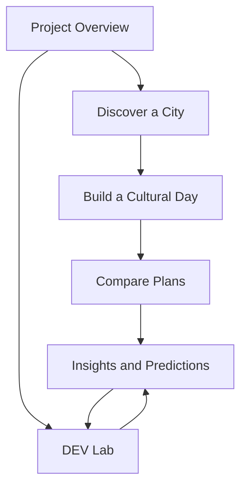

# CultureRoute UI/UX specification

**Status:** Design specification with [current Streamlit behavior](PHASE8_REPAIR.md). Real plans display uncertainty, known fee subtotal, and explicit route failure; the landing-page prototype remains static.
**Visual reference:** supplied 28.8-second Acme template recording
**Product reference:** `CultureRoute_DEV_AAT_Project_Specification.pdf` pp. 1–5, 7–8

## 1. Design approach and reference adaptation

The recording uses a warm paper background, large informal editorial headline, charcoal text, red handwritten emphasis, navy/red doodle marks, pale yellow taped notes, thin outlines, offset cards, and a long narrative scroll. CultureRoute adopts that visual language while replacing the template's commercial proof, pricing, blog, and testimonials with truthful study scope, planner comparison, methods, and provenance. The current landing page demonstrates that adaptation; it is not one of the six connected application screens.

| Template element | CultureRoute replacement | Content rule |
| --- | --- | --- |
| Acme team headline and trial CTA | “Explore the culture behind every route”; city and DEV Lab paths | No claim of a live booking service. |
| Adoption/uptime numbers | 45 cities, 675 attractions, 411 trips, 24 distinct tables | Label as synthetic study scope. |
| Generic features | Discover, Build, Compare, Insights, DEV Lab | Tie each card to a specified screen. |
| Illustrated blog cards | Four category photo cards: heritage, museums, religious sites, food | Photos are illustrative, not database evidence. |
| Testimonials | Method/provenance and research question | No invented users or endorsements. |
| Pricing | Planner versus evaluator experiences | No subscription or price claim. |
| FAQ | Matrix coverage, synthetic data, read-only analysis, feasibility | Answers project-specific uncertainty. |

The landing page uses the supplied green landscape, fort, ornate interior, Golden Temple, and food images. The cliffside monastery photo is excluded because it appears outside the India-only study scope. Displayed photos enlarge and glow on hover; reduced-motion users retain a static presentation. Do not identify an unlabeled photograph as a particular database row or attraction.

## 2. Design system

| Token | Value | Usage |
| --- | --- | --- |
| Paper | `#f7f3e9` | Main canvas. |
| Ink | `#292925` | Main copy and headings. |
| Oxblood | `#982b32` | Emphasis, active outlines, doodles. |
| Muted ink | `#746f68` | Secondary text. |
| Sticky note | `#eee3a6` | Caveats and scope notes. |
| Sketch blue | `#526376` | Secondary marks and diagrams. |
| Line | `#b6afa3` | Rules, card borders, table dividers. |

The prototype uses system typography with a handwritten-style display fallback. For production, select licensed fonts with full support for the chosen Indian-language interface. Keep the sketch style in presentation surfaces; data tables, form labels, long text, and numbers need a legible plain sans-serif. Decorative arrows/stars are hidden from assistive technology. Information must never depend on a doodle or color alone.

### Layout and responsive proposal

- Desktop: persistent top navigation; content max width around 1,600 px; two-column hero and analytical layouts; paired plan/map-timetable comparison where room allows.
- Tablet: two-column card grids, reduced side margins, stacked section headers.
- Mobile: single-column form and cards, horizontally accessible data tables, plan switcher with persistent labels, and map/timetable tabs or stacked panels with matching stop numbers. No horizontal page overflow.
- Preserve result context when switching Chart/Table/How calculated, or plan A/B, using the same filter/input snapshot.
- Image hover grows/glows only on hover-capable pointers; interactive controls must still have visible keyboard focus. Honor `prefers-reduced-motion`.

The exact breakpoints and component library are implementation choices. The static prototype uses CSS breakpoints at 1,000, 760, and 540 px as a visual starting point.

## 3. Sitemap and navigation

Each screen has a title, one-sentence purpose, current source snapshot/cutoff where relevant, breadcrumb or persistent nav, and a path back to the prior task. The main navigation should keep traveler and evaluator destinations visible. [Spec p. 3]

## 4. Screen specifications

### 4.1 Project Overview — FR-01

**Primary content:** research question; two experience paths; SDG 8.9 connection and explicit evidence limit; 45/675/411 counts; synthetic-data banner; source summary; ready-to-run Jaipur example. The hero CTA leads to Discover/Build; the secondary CTA leads to DEV Lab. The page must not describe synthetic interactions as actual visits.

**Desktop wireframe:** hero statement + short description and illustration; four study-scope cards; research/SDG section; two experience cards; method note. **Mobile:** same reading order in one column. **States:** source-unavailable notice if counts cannot be loaded; no silently stale counts.

### 4.2 Discover a City — FR-02, FR-03

**Inputs:** city picker; category, entry-price, and step-free filters; reset. **Main content:** map and table/list of 15 attractions, category and cost/currency, access status, guide languages and specialties, cultural share with numerator/denominator, and a clear distinction between catalog POIs and the 10 per city with recorded route legs. [Spec pp. 3, 5]

**Desktop wireframe:** filters in a stable side/top rail; map alongside sortable attraction table; details on selection. **Mobile:** filters in an accessible disclosure, map/list toggle, sticky result count. **States:** loading, zero matches, missing coordinates, no guide profile, no matrix coverage. Do not label a stop “accessible transfer” from attraction access data alone.

### 4.3 Build a Cultural Day — FR-04, FR-05, FR-07

**Inputs:** city, local date, start time, budget with INR label, hours, number of distinct stops, category preferences, step-free preference, travel-mode preference if approved. Validate in place and explain accepted ranges. **Output:** input summary, feasibility status, schedule and route map kept together, stop arrival/visit/wait/departure, directed mode per leg, itemized entry and between-stop fares, total and estimated between-stop carbon, source-row links. [Spec pp. 3–5]

**Desktop wireframe:** input panel left; map top-right, timetable directly under/next to it; totals visible without scrolling past both. **Mobile:** form first, result summary second, map and timetable as coordinated tabs or stacked panels with matching numbered stops. **States:** invalid input, searching, no candidate stops, missing legs, closed stop, budget/time exceeded, unknown opening hours, conditional feasibility, calculation error. Changing any input marks the old result stale until rerun.

### 4.4 Compare Plans — FR-06, FR-07

Show **Fastest plan** and **Most cultural stops** with consistent red/blue labels, the same frozen input snapshot, aligned maps and timetables, and rows for cultural stops, elapsed time, entry + between-stop cost, estimated between-stop carbon, and coverage warnings. Highlight a difference only when one exists. [Spec pp. 3, 5]

**Desktop wireframe:** two equal plan columns with synchronized stop detail and a compact comparison strip. **Mobile:** labeled plan switcher, pinned comparison metrics, accessible view of each full timetable. **States:** objectives return the same route; one/both infeasible; changed constraint awaiting rerun; unknown hours. The synthetic Jaipur baseline is generated live; real-place results are classified separately.

### 4.5 Insights and Predictions — FR-08, FR-09, FR-13

**Inputs:** city/category filters, weekly/monthly switch, date range, reset. **Output:** cultural listing/interaction/stop shares with three separate denominators; charts with companion table and How calculated view; units, sample size, date cutoff and filters; actual/predicted weekly counts and MAE; missing-footfall method comparison with observed/estimated labels. [Spec pp. 2–3, 6–8]

**Desktop wireframe:** filter rail + main visualization, three-mode tabs, provenance drawer. **Mobile:** filters above chart, accessible table directly below, calculation details in disclosure. **States:** zero denominator, incomplete period, insufficient history, missing values, prediction unavailable, estimate uncertainty. Use text labels such as “Observed”, “Missing”, and “Estimated” beside color or pattern.

### 4.6 DEV Lab — FR-10, FR-11, FR-12, FR-14

**Inputs:** raw/prepared table selector; Guided Mode filter/derive/Group By/pivot/merge controls; SQL Mode editor clearly marked “Read-only”; run/reset/export. **Output:** grain, schema, row/missing counts, before/after tables, exact command or parameters, matched/unmatched join counts, chart/table/calculation view, source IDs, CSV/Parquet export. [Spec pp. 3–5]

**Desktop wireframe:** source browser left, operation panel top/right, preview and result tables in a two-pane comparison, chart below. **Mobile:** sequential tabs/steps: Source → Operation → Result → Explanation/Export. **States:** invalid column/key, disallowed SQL, timeout, row cap/truncation, empty result, export error. Show the 352/11/303 join fixture as a guided example with its distinct-ID grain.

## 5. Component and interaction inventory

| Component | Behavior | Accessibility rule |
| --- | --- | --- |
| Navigation | Links all six screens; active screen indicated. | Text labels, visible focus, skip-to-content. |
| Filter control | Apply/reset with visible active chips and result count. | Native label, keyboard operation, announced count update. |
| Map marker + table row | Selecting either highlights the same POI/stop. | Table is a full text alternative; marker has accessible name. |
| Plan card | Identifies objective and shows comparable metrics. | Objective text is never color-only. |
| Analysis tabs | Chart/Table/How calculated share result state. | Tab semantics, arrow-key behavior, visible active state. |
| Data-state badge | Observed/Missing/Estimated/Conditional. | Text plus icon/pattern/color; meaning explained. |
| Provenance drawer | Source rows, IDs, filters, numerator/denominator, cutoff. | Close button and focus return. |
| SQL editor | Read-only scope and limits shown before run. | Error linked to relevant line/control; no silent truncation. |
| Export | Downloads visible result and metadata. | Named format, row count and status message. |

## 6. Content and chart rules

1. Use “listed attractions,” “matched interactions,” and “selected planned stops” as three distinct populations. Do not call interactions visits.
2. Every percentage shows numerator and denominator in How calculated; city/category/date filters apply to both. Use one decimal for shares while keeping unrounded computation.
3. Display money with currency and two decimals; carbon in kg with three decimals where source precision supports it; duration in hours/minutes with source minutes available.
4. Label route carbon **estimated between-stop carbon** and route cost **entry fees + between-stop travel**. The UI must not imply accommodation or travel to/from the first/last stop is included.
5. Forecast charts mark source cutoff, target week, actual and predicted values, model, and MAE; partial weeks have a visible label.
6. Do not use invented testimonials, subscription prices, user counts, real-world economic claims, or photos as evidence of a synthetic attraction row.

## 7. Handoff and validation

The current [prototype](../site/dist/index.html) is a visual landing page with supplied images, category cards, overview metrics, Jaipur baseline cards, DEV Lab explanation, and FAQ. It is not a high-fidelity implementation of the six screens above. The attached recording governs visual direction, while the specification governs content and behavior.

Before UI sign-off, review desktop/tablet/mobile screenshots; test keyboard-only flows and screen-reader names; check color contrast and focus; verify no image glow clips adjacent content; verify reduced-motion behavior; reconcile every displayed number with [`audit_sources.py`](audit_sources.py); and run the Jaipur and DEV Lab workflows against the connected app once built. Browser visual QA of the current local prototype was unavailable in this session because the browser URL policy blocked the local file preview.
