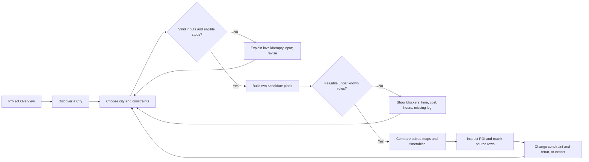
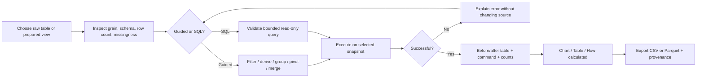
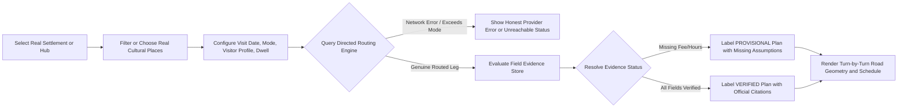

# CultureRoute end-to-end workflows

**Status:** Proposed workflows plus [implemented local traveler flow](PHASE8_REPAIR.md). Missing venue evidence yields a qualified plan; missing route yields a failure.
**References:** `CultureRoute_DEV_AAT_Project_Specification.pdf` pp. 3–5, 8; [`PRD.md`](PRD.md), [`TRD.md`](TRD.md), [`DATABASE.md`](DATABASE.md)

## 1. Shared workflow rules

All flows start from a pinned source snapshot and display a synthetic-data notice. A result carries an input/filter snapshot, source version, calculation method, and the IDs needed to inspect source rows. A changed input invalidates dependent output. Source rows are read-only. Observed, missing, and estimated values have text labels as well as color cues. [Spec pp. 2–5]

## 2. Traveler: choose, generate, compare, inspect

| Step | Actor and trigger | UI state and backend action | Output / exception | PRD IDs |
| --- | --- | --- | --- | --- |
| T1 Discover | Traveler selects a study city. | Show 15 catalog POIs, map, category/price/step-free filters, guide languages/specialties, and 10/15 route coverage note. | Empty filters show a clear reset action. | FR-02, FR-03 |
| T2 Configure | Traveler enters local date, start, budget/currency, hours, stop count, preferences. | Validate required fields, supported currency, positive limits, and agreed stop cap; echo normalized inputs. | Field-specific validation with focus on the first issue. | FR-04 |
| T3 Search | Traveler chooses Generate. | Read eligible POIs and recorded directed walking/cab legs; evaluate known hours, wait, visit, travel, cost. | Progress state, then feasible/conditional/infeasible result. Unknown hours and transfer accessibility are flagged. | FR-05, FR-07 |
| T4 Compare | Plans return under the same frozen inputs. | Label **Fastest plan** and **Most cultural stops** consistently; align stop IDs across map and timetable. | Duration, cultural count, entry fees, leg fares, combined cost, estimated between-stop carbon. If one route wins both, say so. | FR-06 |
| T5 Trace | Traveler opens a stop, leg, or total. | Reveal source POI/matrix IDs and arithmetic, with units/currency. | Source rows and exclusions; absent leg shown as coverage gap, not zero travel. | FR-05, NFR-01 |
| T6 Revise/export | Traveler changes a constraint or downloads table. | Invalidate old plan pair, rerun both objectives, or export visible rows and metadata. | New result tied to new input snapshot; export failure is explained. | FR-07, FR-14 |

### Jaipur acceptance fixture

The specified Saturday example starts at 09:00 with six hours, INR 1,000, and three distinct stops. The expected fastest plan has one cultural stop, 3h27 elapsed, INR 585.46 entry plus travel, and 1.806 kg estimated between-stop carbon. The expected most-cultural plan has two cultural stops, 3h47 elapsed, INR 638.30, and 2.840 kg. These are target values to reproduce and trace to source IDs when planner code exists; the current landing page only illustrates them. [Spec p. 5]

### Traveler exception branches

| Condition | Required response |
| --- | --- |
| No POIs after preference/accessibility filter | Show the active filters, count zero, and one-click reset. |
| No directed leg for a candidate pair | Exclude that transition; explain limited matrix coverage. Do not infer reverse direction or straight-line fare. |
| Closed on selected day or visit exceeds closing time | Reject that sequence and show which stop caused it. |
| Opening hours unknown | Follow the approved conditional-plan policy and label uncertainty; never claim a verified opening. |
| Budget or window exceeded | Show the constraint and a concrete input to adjust. |
| No feasible plan under either objective | Show one shared infeasibility state, not empty comparison cards. |
| Export error | Keep visible result; explain that download failed and allow retry. |

## 3. Evaluator: inspect, transform, explain, export

| Step | Actor and trigger | UI state and backend action | Output / exception | PRD IDs |
| --- | --- | --- | --- | --- |
| E1 Select | Evaluator chooses a raw table or prepared view. | Show source pack/table, grain, schema, row count, missing-value profile, preview, and scope. | Unavailable source gets a named error. | FR-10 |
| E2 Configure | Evaluator chooses Guided Mode operation or SQL Mode. | Guided controls generate a visible pandas/SQL-like command; SQL editor is explicitly read-only with limits. | Invalid keys/columns or unsupported SQL identified before run. | FR-11, FR-12 |
| E3 Execute | Evaluator runs operation. | Read allowed data; enforce query limits; calculate before/after row counts and merge match status. | Result, truncation notice, or safe failure. Source remains unchanged. | FR-11, FR-12 |
| E4 Explain | Evaluator switches output views. | Chart, Table, and How calculated use the same result snapshot. | Units, sample size, filters, source IDs, method. | FR-08, NFR-01 |
| E5 Export | Evaluator chooses CSV/Parquet. | Export the displayed result with metadata or companion manifest. | File count and filters reconcile to visible result. | FR-14 |

### Merge acceptance fixture

Use **distinct POI IDs**, not raw save events or itinerary items. The saved side has 363 IDs; the selected-planned side has 655. Inner join returns 352 IDs, left join 363, and full outer 666: 352 both, 11 saved only, 303 planned only. A full-outer null means the ID is absent from that *set*, not that the attraction itself is missing. The source audit reproduces these values. [Spec p. 5]

## 4. Evaluator: weekly forecast

1. Select Insights and Predictions and the weekly cultural-interaction measure. Show its exact population: matched POI actions on the four cultural categories in Indian cities. [FR-08]
2. Parse offset-aware `occurred_at`, group Monday–Sunday weeks, and exclude the final incomplete week. The current data have 57 complete weeks. [FR-09]
3. For each of the last 12 complete target weeks, display actual count, previous-week prediction, four-week-mean prediction, and training cutoff preceding the target. [FR-09]
4. Calculate and show MAE 3.42 and 3.88 after two-decimal rounding, plus a table and “How calculated” explanation. These are source-audit baselines, not real travel demand. [Spec p. 8]
5. If fewer than five complete weeks remain after a filter, disable the four-week model and explain insufficient history. This is a proposed error state.

## 5. Evaluator: missing-footfall exercise

1. Select `india_events`: 225 events, of which 46 have null `expected_footfall` in the supplied snapshot. Show missingness as 46/225 and preserve the null source cells. [FR-13]
2. Compare summaries using known-only rows, median replacement, and a fitted-distribution estimate. The fitting family is an open technical decision. [FR-13]
3. Hide a reproducible subset of known values, fit each method on the remaining known rows, and reveal error on held-out values. Mark every estimate with text and color. [FR-13, NFR-05]
4. Export derived estimates separately from the raw table with method, seed, training count, and date/version metadata. Do not present estimated footfall as observed attendance. [FR-14]

## 6. Presentation path and evidence checklist

The project specification suggests this demo sequence: generate two Jaipur plans → change budget → trace a route cost to its source → run join or pivot → chart the result → show forecast and error. [Spec p. 8]

| Demo checkpoint | Required evidence |
| --- | --- |
| Scope | 45/675/411 and synthetic-data notice. |
| Route | Same inputs for both objectives, three distinct stops, source POI/matrix IDs, exact decimal totals. |
| Revision | Old result invalidated and both plans recomputed. |
| Transformation | Command, before/after tables, 352/11/303 match breakdown. |
| Chart | Table parity, numerator/denominator, units, filters, cutoff. |
| Forecast | 57 complete weeks, 12 past-only predictions, MAE 3.42/3.88, dates. |

None of these checkpoints should be marked “passed” until the connected application is implemented and run. The source audit currently verifies the data and forecast arithmetic; it does not implement the website or planner.

## 7. Real-place traveler: discover, route, plan, verify (Phase 8)

| Step | Actor and trigger | UI state and backend action | Output / exception |
| --- | --- | --- | --- |
| R1 Select | Traveler selects settlement, hub, or custom IDs. | Query `places` and `settlements` in `real_catalog.db`. Show genuine coordinates, cultural categories, and field evidence status. | Strict namespace validation: `poi_` and `cty_` synthetic IDs rejected with explicit `ValueError`. |
| R2 Route | Backend evaluates travel legs. | Query persistent `real_route_legs` cache or genuine directed OSRM provider. Walking > 25 km explicitly pruned. | Genuine road geometry extracted. Fabricated straight-line multipliers and coordinate biases strictly forbidden. |
| R3 Evidence | Backend checks admission and hours. | `VenueEvidenceStore` evaluates date and visitor profile (`INDIAN_ADULT`, `FOREIGN_ADULT`, `CHILD`). | Unknown admission is never treated as ₹0; missing fields labeled as traveler/system assumptions. |
| R4 Plan | Planner generates ordered day itinerary. | Evaluates dual objectives (Fastest / Most Cultural) with timetable, wait times, visit duration, and optional return leg. | Classifies result as `VERIFIED` (all primary evidence present) or `PROVISIONAL` (missing assumptions). Infeasibility explicitly explained. |
